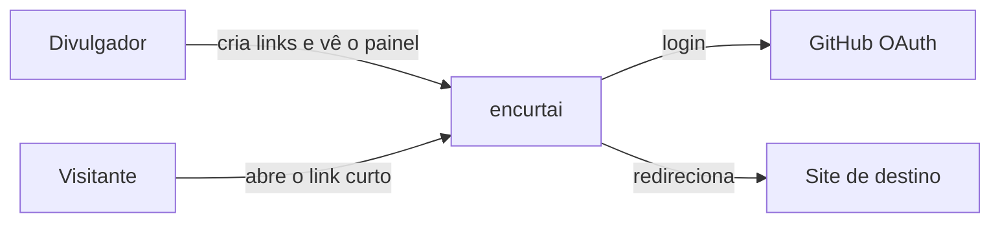
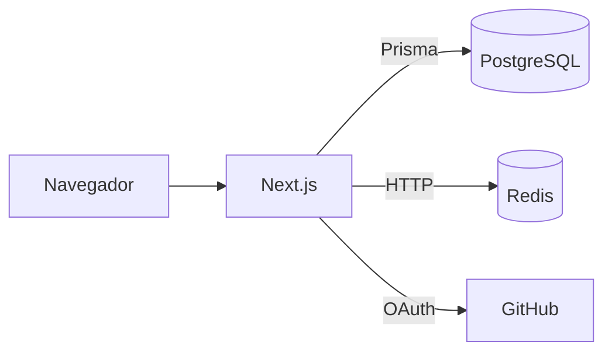
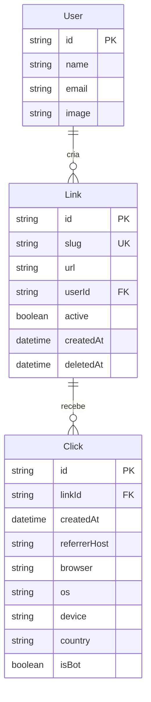
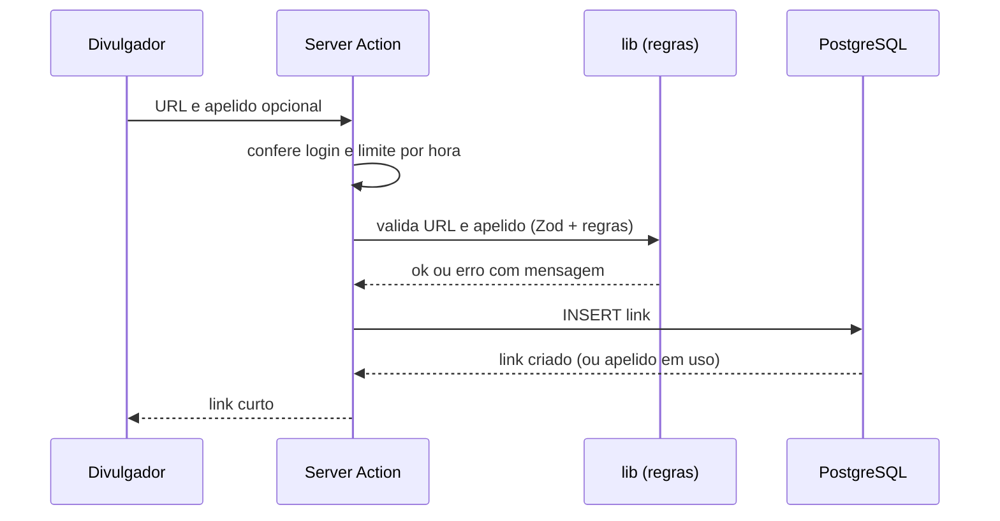
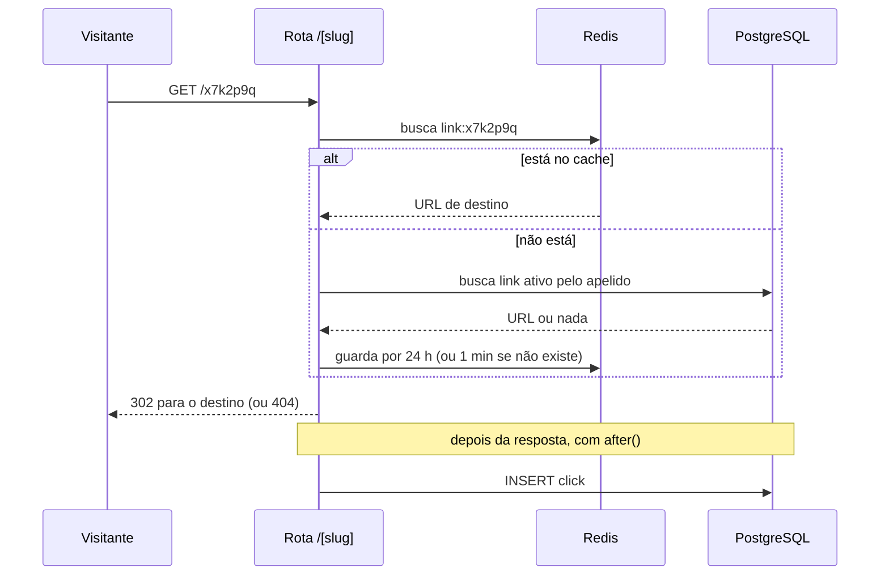

# Arquitetura: encurtai

## 1. Estilo arquitetural

**Monolito organizado por funcionalidade**: um único app Next.js entrega as telas, as ações do servidor e a rota de redirecionamento.

Por que monolito:
- O domínio é pequeno: links e cliques. Uma pessoa desenvolve.
- Um deploy só, um repositório só, um lugar para depurar.
- O Next.js já separa o que roda no servidor do que roda no navegador.
- A parte que precisa ser rápida (o redirecionamento) é uma rota isolada. Se um dia precisar escalar separado, dá para extrair sem reescrever o resto.

Alternativas avaliadas (detalhe no [ADR 0001](adr/0001-monolito-nextjs.md)):

| Alternativa | Por que não agora |
|---|---|
| API separada (Express) + front React | dois deploys, CORS e autenticação entre serviços, sem ganho para um projeto deste tamanho |
| Microsserviço só para o redirecionamento | otimização antes da hora; o cache já resolve a velocidade |
| Monolito modular com contratos entre módulos | com só dois domínios, pastas por funcionalidade bastam |

## 2. Contexto

Quem usa o sistema e com quais serviços externos ele conversa.



## 3. Containers

| Container | Tecnologia | Responsabilidade |
|---|---|---|
| App web | Next.js na Vercel | telas, Server Actions, rota de redirecionamento |
| Banco | PostgreSQL no Neon | usuários, links e cliques |
| Cache | Redis no Upstash | apelido → URL e contadores do limite de requisições |
| Login | GitHub OAuth | identidade do usuário |



## 4. Organização do código

Três camadas simples dentro do monolito:

| Camada | Pasta | O que faz | Regra |
|---|---|---|---|
| Rotas e telas | `src/app/` | recebe a requisição, chama a ação, mostra o resultado | sem regra de negócio |
| Ações | `src/actions/` | confere o login, valida a entrada com Zod, chama `lib` | uma ação por caso de uso |
| Regras e dados | `src/lib/` | regras puras (apelido, URL, user-agent, estatísticas) e acesso ao banco e ao cache | não importa nada de `app/` |

As regras puras ficam em arquivos sem acesso a banco, então são testadas rápido e sem mock.

```
encurtai/
├── prisma/
│   ├── schema.prisma
│   └── migrations/
├── src/
│   ├── app/
│   │   ├── [slug]/route.ts        # redirecionamento
│   │   ├── dashboard/
│   │   │   ├── page.tsx           # meus links
│   │   │   └── links/[id]/page.tsx
│   │   ├── login/
│   │   └── page.tsx
│   ├── actions/
│   │   └── links.ts               # criar, desativar, reativar, excluir
│   ├── components/
│   └── lib/
│       ├── auth.ts
│       ├── db.ts
│       ├── redis.ts
│       ├── rate-limit.ts
│       ├── slug.ts                # gerar e validar apelido
│       ├── url.ts                 # validar URL de destino
│       ├── user-agent.ts          # navegador, sistema, aparelho, robô
│       └── stats.ts               # consultas e formatação do painel
├── tests/
│   ├── unit/
│   ├── integration/
│   └── e2e/
├── docker-compose.yml
└── .env.example
```

## 5. Modelo de dados



- `Account` e `Session` são as tabelas padrão do Auth.js e ficam fora do diagrama.
- A exclusão é lógica (`deletedAt`): a linha continua no banco para o apelido nunca ser reaproveitado (RN06).
- Índice em `Click(linkId, createdAt)`, porque todas as consultas do painel filtram por link e período.
- Nada de IP. O país vem do cabeçalho `x-vercel-ip-country` e, da origem, fica só o domínio.

## 6. Fluxos principais

### 6.1 Criar link



### 6.2 Redirecionar



### 6.3 Painel

Os gráficos vêm de consultas de agregação. Exemplo dos cliques por dia, com os dias sem clique preenchidos com zero:

```sql
SELECT d::date AS dia, COUNT(c.id) AS cliques
FROM generate_series(current_date - 29, current_date, interval '1 day') AS d
LEFT JOIN "Click" c
  ON c."linkId" = $1
 AND c."isBot" = false
 AND c."createdAt" >= d
 AND c."createdAt" < d + interval '1 day'
GROUP BY d
ORDER BY d;
```

## 7. Decisões técnicas

| Decisão | Escolha | Registro |
|---|---|---|
| Estilo arquitetural | monolito Next.js por funcionalidade | [ADR 0001](adr/0001-monolito-nextjs.md) |
| Velocidade do redirecionamento | cache no Redis por 24 h e cache de "não existe" por 1 min | [ADR 0002](adr/0002-cache-do-redirecionamento.md) |
| Registro do clique | gravar depois da resposta com `after()` | [ADR 0003](adr/0003-clique-depois-da-resposta.md) |
| Login | Auth.js com GitHub | [ADR 0004](adr/0004-login-com-github.md) |

Escolhas sem ADR, por serem padrão de mercado: Prisma (ORM mais usado com TypeScript, com migrações), Zod (validação), Tailwind CSS, Recharts (gráficos), nanoid (apelido aleatório), Vitest e Playwright (testes).

## 8. Segurança

| Camada | Medida |
|---|---|
| Entrada | Zod em toda ação; URL só `http`/`https`, até 2.048 caracteres, sem apontar para o próprio domínio |
| Autenticação | login delegado ao GitHub; nenhuma senha guardada |
| Autorização | toda ação e todo painel filtram pelo `userId` da sessão; link de outro usuário devolve 404 |
| Abuso | 20 links por hora por usuário (Upstash Ratelimit); cache de apelido inexistente contra varredura |
| Dados pessoais | sem IP, sem URL completa de origem, só país e domínio |
| Cabeçalhos | `Content-Security-Policy`, `X-Content-Type-Options` e `Referrer-Policy` configurados no Next.js |
| Segredos | só em variáveis de ambiente; `.env.example` sem valores reais |
| Dependências | Dependabot e `npm audit` no CI |

## 9. Ambientes e deploy

| Ambiente | Onde | Banco e cache |
|---|---|---|
| Desenvolvimento | máquina local | docker-compose com PostgreSQL, Redis e serverless-redis-http (para falar o mesmo protocolo do Upstash) |
| Preview | Vercel, um por pull request | Neon (branch de banco) e Upstash de teste |
| Produção | Vercel | Neon e Upstash |

Esteira do CI (GitHub Actions), a cada push: lint → checagem de tipos → testes unitários → testes de integração (Postgres e Redis como serviços do Actions) → build → testes ponta a ponta.

## 10. Observabilidade

- Logs de erro da Vercel, com o id da requisição e sem dados pessoais.
- Página de erro amigável para o usuário; o detalhe fica só no log.
- Medição do tempo de redirecionamento com autocannon antes de cada versão, com o resultado no README.
